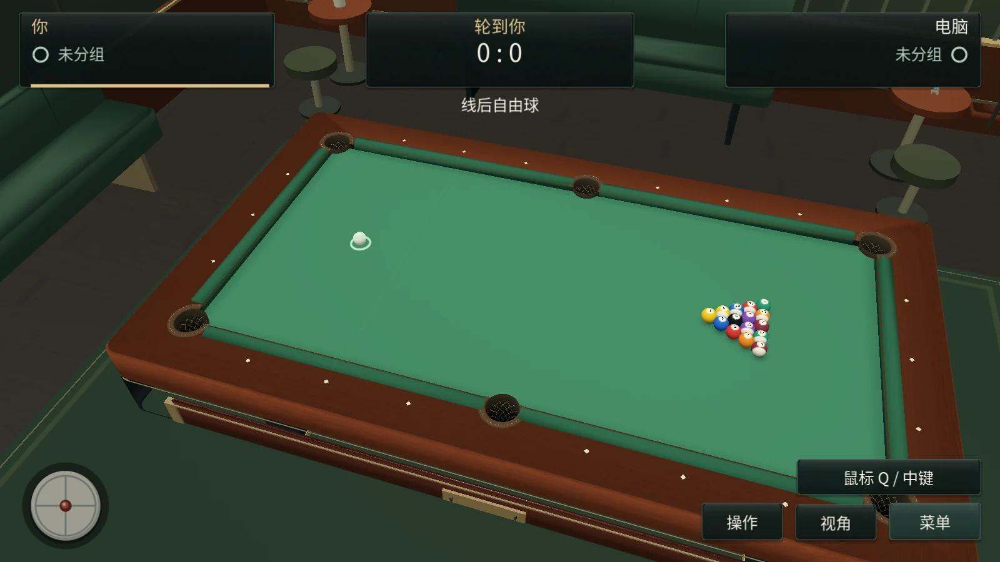

# 123台球

中式八球游戏。公开试玩提供 Windows 客户端与浏览器两种版本。

[在线试玩](https://mootra.github.io/pool3d/) · [Windows 试玩](https://github.com/Mootra/pool3d/releases)

## 关于本仓库

本仓库只包含公开试玩的页面、发布配置和说明，不包含完整版源码。

## 公开试玩

试玩为离线版本，免登录，包含：

- 人机对战：三档 AI，可在局中切换，保留当前球局。
- 2D 全桌与 3D 第一人称两种视角。
- 击球练习：中袋直球、底袋切球、贴库长球，支持自定义摆球。

## 完整版

完整版在试玩内容之外提供：

- 联机对战：预建账号、四张球桌、邀请与准备。
- 对局恢复：断线后保留座位两分钟，重新登录可接回原局。
- 在线战绩：仅统计双方登录的联机对局，每局记录一次。
- 球房与聊天：三套球房风格、菜单音乐、对局内聊天。

完整版不公开下载，不提供公开匹配、注册或排位。

## 下载

- 浏览器：<https://mootra.github.io/pool3d/>。桌面 Chrome 或 Edge，鼠标与键盘。
- Windows x64：[Releases](https://github.com/Mootra/pool3d/releases)。完整解压后运行 `pool3d.exe`，免安装。

## 版本

当前版本为 alpha.11。完整版仍在开发中；联机对局的长局、不同设备表现与真人操作手感尚在验证。试玩与完整版均按现状提供。

## 许可

原创代码、美术与交互内容版权归作者所有。第三方组件与素材许可见试玩内的许可页。
