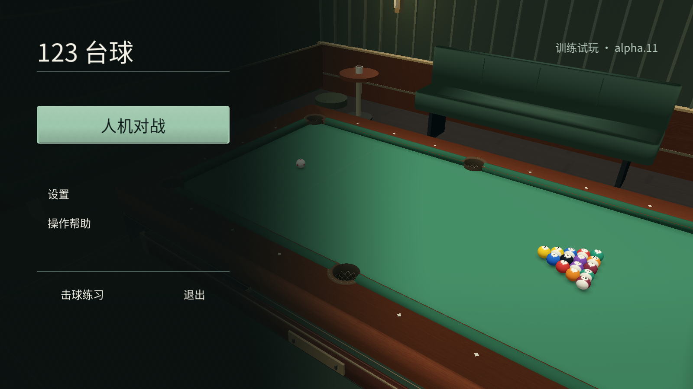
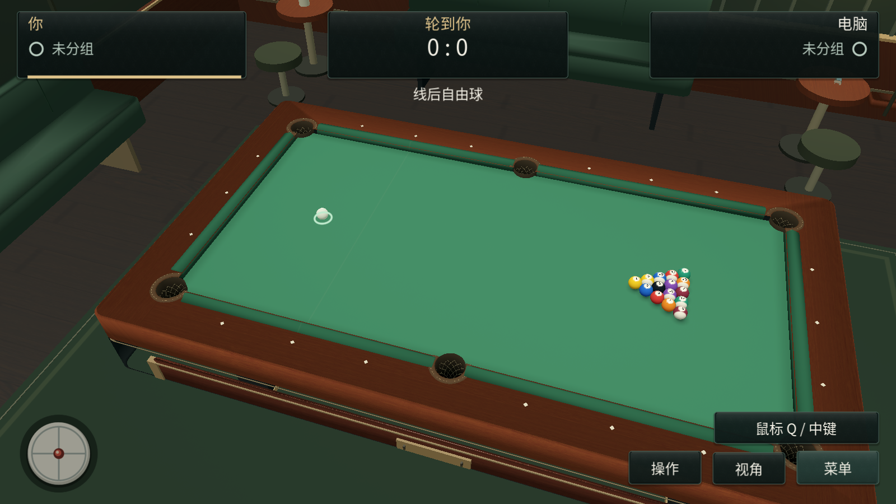
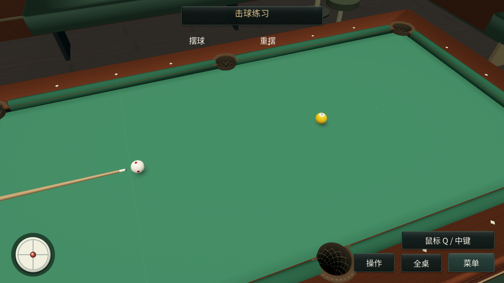

# 123 台球 · 训练试玩

Windows x64 离线台球试玩，包含人机对战、三级 AI 难度、2D 俯视与 3D 第一人称操作，以及可编辑摆球的击球练习。

从 [Releases](https://github.com/Mootra/pool3d-demo/releases) 下载 ZIP，完整解压后运行 `pool3d-demo.exe`。首次体验建议从游戏内“操作帮助”开始。设置独立保存在 `%APPDATA%\Pool 3D Demo\`。

本仓库提供试玩程序、画面和使用说明；完整项目源码独立维护。试玩不提供在线账号及好友房间功能。

基于 alpha.11，使用 Godot 4.5.1 Compatibility 渲染器。当前为开发版本；不同电脑的长局稳定性和操作体验仍需实际验证。

游戏原创代码、美术与交互内容版权归作者所有。第三方组件与素材声明随下载包提供。

