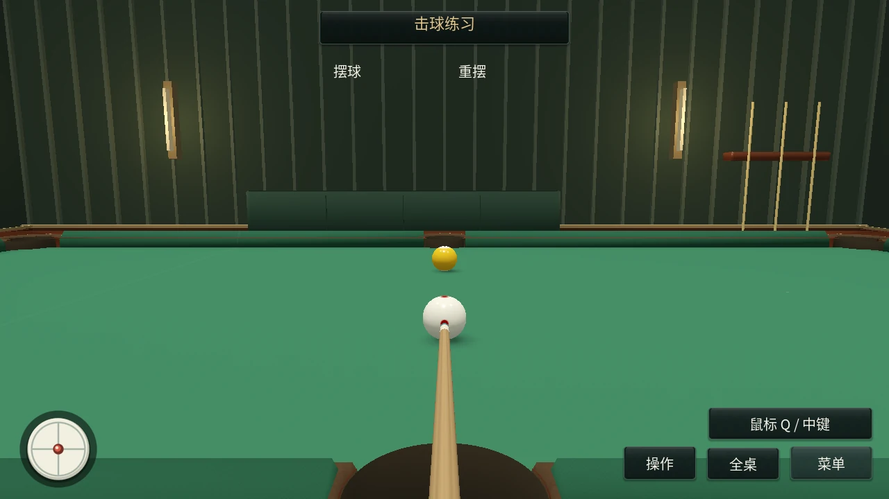

# 123台球

[浏览器试玩](https://mootra.github.io/pool3d-demo/) · [下载 Windows 版](https://github.com/Mootra/pool3d-demo/releases/tag/v1.0.0-alpha.11-demo)

中式八球训练游戏，提供浏览器和 Windows 试玩。试玩支持离线人机对战与击球练习，免登录。

## 试玩内容

- **2D 全桌与 3D 第一人称**。2D 支持点锁和滚轮微调，3D 支持后拉控力、前送出杆。
- **三档 AI 对战**。AI 根据球局模拟选择进攻、走位或防守，遵循与玩家相同的裁判规则。难度可在局中切换。
- **击球练习**。内置中袋直球、底袋切球、贴库长球。支持自定义摆球和重摆。

## 开始试玩

- **浏览器**。使用桌面 Chrome 或 Edge、鼠标和键盘。3D 瞄准需要允许锁定鼠标。
- **Windows x64**。完整解压 ZIP，运行 `pool3d-demo.exe`。设置保存在 `%APPDATA%\Pool 3D Demo\`。

## 构建与许可

试玩基于 **alpha.11**，使用 Godot 4.5.1 Compatibility。完整源码和好友联机服务端在私有仓库维护。

- **Windows 版** · [构建信息](build.json) · [下载校验](SHA256SUMS.txt)
- **浏览器版** · [构建信息与校验](web-build.json) · [第三方许可](https://mootra.github.io/pool3d-demo/play/alpha11/licenses/)

原创代码和素材版权归作者所有。Windows 包内附第三方许可。
